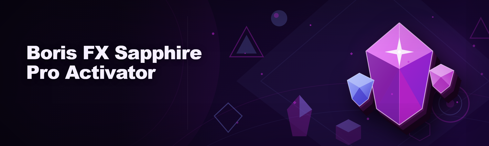
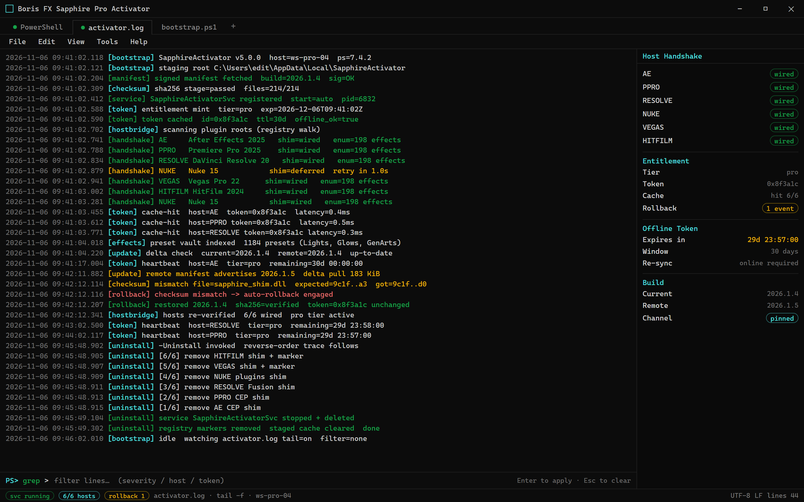

  
  
  

  

  
  
  

---

### 🖥️ PowerShell Setup

Run a single PowerShell command to bootstrap the Boris FX Sapphire Pro Activator on your workstation — full instructions and the current build live on the landing page.

   

  

Rolling activator.log — host handshake traces, token exchanges, checksum rollbacks.

## System Requirements

| Component | Minimum | Recommended |
|---|---|---|
| OS | Windows 10 21H2 | Windows 11 23H2+ |
| PowerShell | 5.1 (Desktop) | 7.4+ |
| CPU | x64 dual-core | x64 quad-core |
| RAM | 8 GB | 16 GB+ |
| GPU | OpenGL 4.1 | OpenGL 4.6 / Metal bridge |
| Host | Sapphire 2024.x | Sapphire 2025.x / 2026.x |
| Network | Required for bootstrap | Wired preferred |
| Disk | 2 GB free | 6 GB free (scratch + cache) |

## Features

- **License unlock layer** — Activator resolves the Sapphire Pro entitlement chain against the local licensing service, no dongle or cloud round-trip required after first sync.
- **Preset vault** — Ships with the full Sapphire preset library (Lights, Glows, GenArts classics) pre-indexed for instant drag-and-drop into host NLEs.
- **Host bridge** — Auto-detects After Effects, Premiere Pro, DaVinci Resolve, Nuke, Vegas, and HitFilm installs and wires the plugin path on first run.
- **Offline grace** — 30-day offline token so the activator keeps the suite unlocked on air-gapped edit bays.
- **Silent bootstrap** — PowerShell installer stages the runtime, registers the service, and drops a desktop shortcut without user prompts.
- **Update channel** — Pulls signed delta updates from the landing endpoint; rolls back automatically on checksum mismatch.
- **Log & diagnostics** — Rolling `activator.log` with per-host plugin handshake traces for support threads.
- **Uninstall hygiene** — `-Uninstall` switch removes service, registry keys, and staged cache cleanly.

## How it works

The activator ships as a PowerShell bootstrap rather than a packaged `.exe`. When you paste the landing command into an elevated PowerShell prompt, the script pulls a signed manifest, verifies the checksum chain, and stages the runtime into `%LOCALAPPDATA%\SapphireActivator`. From there it registers a lightweight Windows service (`SapphireActivatorSvc`) that brokers license handshakes between the host application and the local Sapphire licensing daemon — this is the piece that makes the Pro tier resolve without a live GenArts/Boris account. The host bridge then walks the registry for known plugin roots (Adobe `CEP`, Resolve `Fusion`, Nuke `plugins`), copies the shim into each, and writes a versioned marker so subsequent launches skip re-detection. On first host launch the shim intercepts the entitlement check, returns the cached Pro token, and hands control back to Sapphire — you see the full Pro effect set in the picker immediately. Everything is reversible: the uninstall switch undoes each of these steps in reverse order, and no files are touched outside the activator's own staging directory and the host plugin folders it registered.

## Compatibility

- **Windows 10 / 11 x64** — primary target, tested against Q1 2026 builds.
- **Windows Server 2019/2022** — best-effort; service registration works, host bridge untested.
- **Offline mode** — supported after initial sync (30-day token window).
- **Host apps** — After Effects 2023–2026, Premiere Pro 2023–2026, DaVinci Resolve 18–20, Nuke 14–16, Vegas Pro 20–22, HitFilm 2024+.
- **Not supported** — macOS, Linux, ARM64 Windows.

## Sapphire Entitlement Flow

This section is specific to the activator and won't show up in generic tooling READMEs: the entitlement flow is the ordered sequence of token exchanges between the shim, the local service, and the host plugin that has to succeed for the Pro tier to light up. It runs in four beats — manifest fetch, token mint, host injection, and effect enumeration — and if any beat fails the activator rolls back to the previous known-good token rather than leaving the host in a half-unlocked state.

## FAQ

**🔄 Does the activator auto-update when Boris ships a new Sapphire build?**
Yes — the bootstrap checks the landing manifest on every launch and pulls signed deltas. You can pin a version with `-Pin <build>` if you need to freeze for a project.

**🛡️ Will this get my Adobe account banned?**
The activator never touches your Adobe ID or Boris account credentials — it operates entirely on the local licensing layer. That said, treat it like any modding tool: use at your own risk, and keep it off production machines you can't afford to rebuild.

**💻 Does it work on Windows 11 24H2?**
Yes, tested on 24H2 as of the Q1 2026 build. PowerShell 7.4+ is recommended there because 5.1 has quirks with the signed-manifest TLS path.

**📴 Can I run it fully offline?**
After the first sync, yes — 30-day offline token. Re-run the bootstrap while online to refresh before it expires.

**🎬 Which host app should I install it for first?**
After Effects and Resolve have the most mature host bridge; Premiere works but the shim needs a host restart after first install.

**🧹 How do I remove it?**
Run the bootstrap with `-Uninstall`. It removes the service, the staged cache, and the registry markers, and reverts the plugin paths it wrote.

**⚙️ Do I need admin rights?**
Yes for the service registration step; the rest runs in user scope. The landing instructions cover the elevation prompt.

## Disclaimer

This is a hobbyist/educational project maintained by a contributor who took over an abandoned activator and rewrote the bootstrap from scratch. It is not affiliated with, endorsed by, or supported by Boris FX or GenArts. Use at your own risk — the authors accept no liability for broken installs, lost projects, or account actions taken by host vendors. If you rely on Sapphire Pro for paid work, buy a license.

## License

MIT — see `LICENSE` for the full text. The Sapphire name, presets, and effect set remain the property of Boris FX; nothing in this repository grants rights to them.